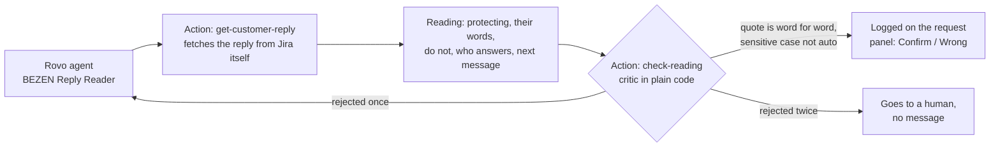

# BEZEN Reply Reader for Jira Service Management (Forge)

A Rovo agent that reads a customer's reply on a request before anyone answers it, and says:
what the customer is protecting, the exact words that show it, what must not be done now,
whether a bot or a human should answer, and the next message.

**Demo video (4:26, Hebrew with full English subtitles):** https://www.youtube.com/watch?v=Phelhc1P0_s

**6 critic tests pass** · **3 replies, 3 different correct decisions** on a live Jira Service Management site · **runs only on Forge**, no external servers or keys · **every quote checked by code, not by the model**

## What it catches

Verified end to end on a demo Jira Service Management site with Rovo:

| Request | The customer's reply | A normal bot | BEZEN Reply Reader |
|---|---|---|---|
| CLSD-6 | *"Where did you get my email address? I never signed up for anything from you. Take me off your list"* | Sees a question, answers it, keeps selling | **Protecting:** their privacy. **Do not:** pitch. **Who answers:** a human must |
| CLSD-7 | A customer asks when it will be ready | Sends a timeline | **Protecting:** their standing with their boss, after convincing management to buy. **Next message:** a clear timeline *and* a backup plan. **Who answers:** a human must |
| CLSD-8 | *"Sounds good, send over the NDA and we'll sign it this week"* | Answers | **Nothing to guard,** the customer is ready. **Who answers:** a bot may, right away |

It does not send everything to a human. Only what needs one.

## The loop



Built for Codegeist 2026 (category: Apps for Business Teams). It is a rebuild on Forge of
[the original BEZEN Reply Reader](../README.md), which read sales replies from a CRM.

## How it works

| Part | What it is | Why it is not a model |
|---|---|---|
| Reader | `rovo:agent` with the BEZEN layer as its prompt (`resource/agent/prompt.txt`) | It is the model |
| `get-customer-reply` | Action. Fetches the reporter's newest comment from Jira, plus earlier readings of this request | The agent never supplies the text it is checked against |
| `check-reading` | Action. Runs the critic (`src/critic.js`) against the reply it fetched itself, and logs the decision on the issue | A quote that is not in the reply is rejected. `intrusion` and `guilt_or_loss` are never auto-answered |
| Retry, then a human | First rejection: one more try. Second: escalated, no message | The count is read from the ledger, so asking again does not reset it |
| Ledger | Issue property `bezen-reply-ledger` | Every reading, pass or fail, stays on the request |
| Panel | `jira:issuePanel` (UI Kit) showing the readings | A human confirms or rejects each reading; the agent never posts to the customer |

## Run it

```bash
npm install
npm test            # critic tests, no Jira and no network
forge register      # once, creates the app id in manifest.yml
forge deploy
forge install       # pick your Jira site with Jira Service Management and Rovo
```

Then open a request, open Rovo chat, pick **BEZEN Reply Reader** and ask it to read the latest reply.
The **BEZEN Reply Reader** panel on the request shows the reading and the critic's decision.
